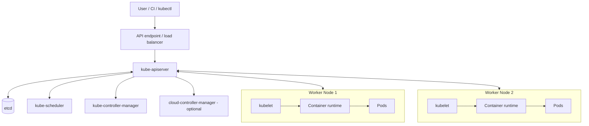

# Kubernetes Cluster Architecture

## 1. Architectural model

A Kubernetes cluster consists of a control plane and one or more worker nodes. The control plane exposes and manages the cluster API and runs control loops. Worker nodes provide the environment in which Pods execute.

A cluster can be small enough to run control-plane and workload components on one machine, or production-grade with multiple control-plane instances, multiple worker pools, external load balancing, replicated storage and provider integrations.



## 2. Control plane

The control plane makes cluster-wide decisions and exposes the Kubernetes API. Its main components are:

- `kube-apiserver`: API front end and validation/admission path.
- `etcd`: consistent key-value store used for Kubernetes cluster data.
- `kube-scheduler`: selects nodes for unscheduled Pods.
- `kube-controller-manager`: runs core reconciliation controllers.
- `cloud-controller-manager`: optional integration for cloud-specific control loops.

The control plane does not normally proxy every application request. The application data path is implemented by the cluster networking and Service implementation.

## 3. Worker nodes

A worker node runs:

- `kubelet`: node agent that ensures Pod containers described by PodSpecs are running.
- Container runtime: creates and manages containers through CRI.
- Network implementation: CNI plugin and, where used, kube-proxy or an alternative Service dataplane.
- Pods: the units scheduled onto nodes.

`kube-proxy` is optional in the sense that some networking implementations provide equivalent Service forwarding without it. Do not assume every cluster has a kube-proxy Pod or process.

## 4. Cluster communication paths

### Management path

Clients and controllers communicate with the API server. Components watch API resources and update status or create dependent objects through the API.

### Node management path

The control plane communicates with kubelets for node and Pod management. Exact connection direction and ports depend on cluster configuration and security architecture.

### Application data path

Pod-to-Pod, Pod-to-Service and external traffic flows are handled by CNI, Service routing, load balancers, ingress/gateway components and network policy enforcement. This path is not equivalent to the control-plane API path.

## 5. High availability considerations

A production control plane commonly uses:

- Multiple API server instances behind a stable endpoint.
- A resilient etcd topology with tested backups and quorum-aware operations.
- Multiple control-plane nodes across failure domains where supported.
- Worker node pools sized for workload capacity and failure tolerance.
- Redundant networking, DNS and load-balancing dependencies.
- Tested upgrade, backup and disaster-recovery procedures.

Three etcd members are often used to tolerate one member failure, but quorum and latency design must be considered. More members do not automatically mean better performance.

## 6. Failure domains

| Failure | Typical effect | Design consideration |
|---|---|---|
| One worker node fails | Pods on that node become unavailable; controllers may replace them | Replicas, topology spread, capacity headroom |
| One API server fails | Remaining API servers may continue serving requests | Multiple instances and stable endpoint |
| etcd quorum lost | API writes can fail; cluster management is impaired | Protect quorum, backups and recovery runbooks |
| CNI failure | Pod networking may fail | CNI health, node logs and network observability |
| DNS failure | Service-name lookups fail | DNS redundancy and CoreDNS monitoring |
| Storage backend failure | Stateful workloads may stall or lose access | Storage redundancy, snapshots and restore tests |

## 7. Inspect architecture from a cluster

```bash
kubectl cluster-info
kubectl get nodes -o wide
kubectl get pods -n kube-system -o wide
kubectl get componentstatuses
```

`kubectl get componentstatuses` is deprecated/removed in modern Kubernetes releases and should not be used as a production health check. Prefer provider-specific health tools, control-plane monitoring, node conditions and component metrics.

On a kubeadm-style control plane, static Pod manifests may be found under `/etc/kubernetes/manifests`, but managed Kubernetes providers generally do not expose host-level control-plane access.

## 8. Troubleshooting approach

1. Confirm the API endpoint is reachable.
2. Inspect node readiness and node conditions.
3. Inspect system Pods in `kube-system` where visible.
4. Check events and component logs using the access model supported by the distribution.
5. Separate control-plane problems from application data-plane problems.
6. Check provider status pages for managed control-plane or load-balancer incidents.

## 9. Interview questions

**Q1. What are the two main parts of a Kubernetes cluster?**  
The control plane and worker nodes.

**Q2. Does the control plane carry all application traffic?**  
No. The API server handles management operations. Application traffic flows through the cluster data plane, Services, CNI and external traffic components.

**Q3. Why is etcd important?**  
It stores Kubernetes API data and is central to cluster state. Its quorum, backup and recovery design are critical.

**Q4. Is kube-proxy mandatory?**  
No. Some network implementations provide Service proxy functionality themselves.

## References

- [Cluster architecture](https://kubernetes.io/docs/concepts/architecture/)
- [Kubernetes components](https://kubernetes.io/docs/concepts/overview/components/)
- [Nodes](https://kubernetes.io/docs/concepts/architecture/nodes/)
- [Operating etcd clusters for Kubernetes](https://kubernetes.io/docs/tasks/administer-cluster/configure-upgrade-etcd/)
