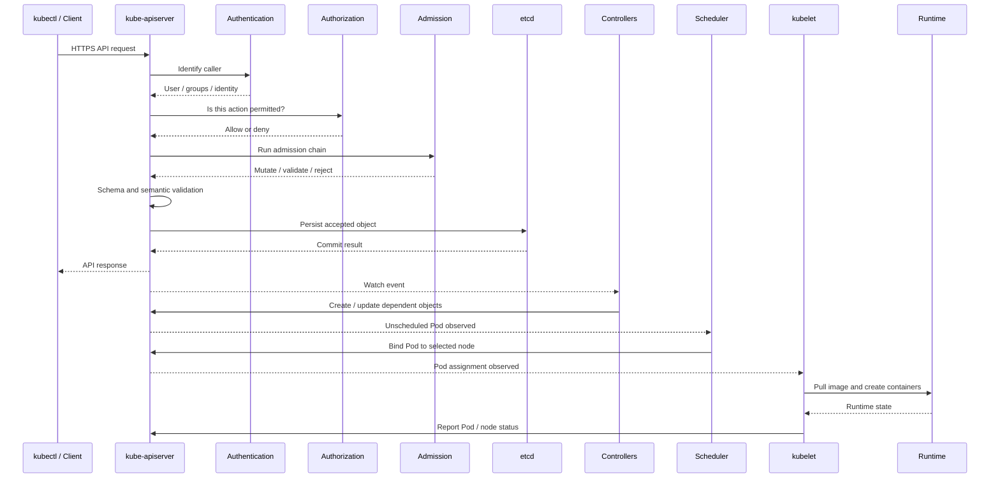

# Kubernetes API Request Lifecycle

## 1. Why the request lifecycle matters

Kubernetes is API-centric. A command such as `kubectl apply -f deployment.yaml` sends an API request; it does not directly start a container. Understanding the request path helps distinguish API acceptance from scheduling, image pulling, container startup and application readiness.

## 2. Simplified request path



This is a conceptual sequence. Real request processing and controller interactions are asynchronous and may involve caches, watches, retries and multiple controllers.

## 3. Request-processing stages

### 3.1 Transport and API endpoint

The client connects to the API server endpoint over HTTPS. TLS protects transport and supports server identity verification. Client authentication may use certificates, bearer tokens, an external identity provider or another configured mechanism.

### 3.2 Authentication

Authentication answers: **Who is making the request?**

The API server obtains an identity and associated groups or user information from configured authentication mechanisms. Kubernetes does not provide a general built-in user database for ordinary human users; identity integration is commonly handled by the cluster distribution or an external identity provider.

### 3.3 Authorization

Authorization answers: **Is this identity allowed to perform this action on this resource?**

The authorization decision evaluates attributes such as user, groups, verb, resource, namespace and API group. Common authorization modes include RBAC and webhook authorization; configuration depends on the cluster.

A denied request commonly returns `Forbidden`.

### 3.4 Admission control

Admission runs after authentication and authorization for requests that create or modify objects. Admission controllers can mutate or validate requests. Examples include defaulting behavior, Pod security enforcement and custom admission webhooks.

A webhook outage or timeout can prevent object creation when its failure policy requires rejection. This is why admission webhooks must be operated as production dependencies.

### 3.5 Validation and persistence

The API server validates the object against API schemas and semantic rules. If accepted, it persists the object through the storage layer, normally etcd. The API response indicates whether the API operation succeeded, not whether the workload is already running.

## 4. Watch and reconciliation

Controllers watch API resources, compare desired and observed state, then submit additional API requests. Watches are not a one-time event queue that guarantees exactly-once processing. Controllers must tolerate retries, reconnects and repeated observations.

The scheduler watches for Pods requiring placement. After binding, the kubelet on the chosen node observes the assignment and works with the runtime to create the Pod's containers.

## 5. Why `apply` can succeed while a Pod fails

An accepted Deployment may still result in a Pod that is:

- Pending because no node satisfies scheduling constraints.
- Waiting because the image cannot be pulled.
- ContainerCreating because storage or networking setup is incomplete.
- Running but not Ready because readiness checks fail.
- Crashing because the application exits or is OOM-killed.

Use resource status and events to follow the later stages:

```bash
kubectl get deployment,pods -n learning -o wide
kubectl describe deployment web -n learning
kubectl describe pod POD_NAME -n learning
kubectl get events -n learning --sort-by=.lastTimestamp
kubectl logs POD_NAME -n learning
```

## 6. API-level debugging

```bash
kubectl config current-context
kubectl cluster-info
kubectl get --raw='/readyz?verbose'
kubectl get --raw='/livez?verbose'
kubectl auth can-i create deployments -n learning
kubectl explain deployment.spec
```

Do not expose API credentials, tokens or client certificate private keys when collecting diagnostics.

## 7. Interview questions

**Q1. What happens after `kubectl apply`?**  
The client sends an API request. The API server authenticates, authorizes, admits and validates the object, persists it, and returns a response. Controllers then reconcile dependent resources; scheduling and kubelet/runtime actions happen asynchronously.

**Q2. What is the difference between authentication and authorization?**  
Authentication establishes identity. Authorization decides whether that identity may perform the requested action.

**Q3. What is admission control?**  
It is an API request processing stage that can mutate or validate create/update requests before persistence.

**Q4. Does the API server start containers?**  
No. The scheduler assigns Pods to nodes, and kubelet coordinates with the container runtime to create containers.

## References

- [Kubernetes API concepts](https://kubernetes.io/docs/concepts/overview/kubernetes-api/)
- [Authentication](https://kubernetes.io/docs/reference/access-authn-authz/authentication/)
- [Authorization](https://kubernetes.io/docs/reference/access-authn-authz/authorization/)
- [Admission controllers](https://kubernetes.io/docs/reference/access-authn-authz/admission-controllers/)
