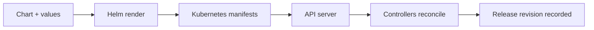

# 01 — Helm Fundamentals and Architecture

Helm is a package manager for Kubernetes. It packages Kubernetes manifests into versioned charts, renders templates using configuration values, and manages named installations called releases.

## Core terms
- **Chart:** package containing templates, metadata, default values, and optional dependencies.
- **Release:** a named installation of a chart in a namespace.
- **Revision:** a versioned state of a release after install/upgrade/rollback operations.
- **Repository:** a distribution endpoint for packaged charts; OCI registries are also supported.
- **Values:** configuration supplied to templates.

## Workflow


## Helm does not replace Kubernetes
Helm renders and submits Kubernetes resources and tracks release state. Kubernetes controllers continue to reconcile Deployments, Services, and other objects. Helm does not provide runtime scheduling, health management, or application observability by itself.

## Common commands
```bash
helm version
helm repo list
helm search repo nginx
helm list -A
helm status <release> -n <namespace>
```

## Helm 3 and later
Helm 3 removed the old Tiller server component. Helm clients use the Kubernetes API with the caller's credentials and permissions. Treat Helm permissions as Kubernetes API permissions: a user able to install a chart may create every resource allowed by that chart and their authorization.
