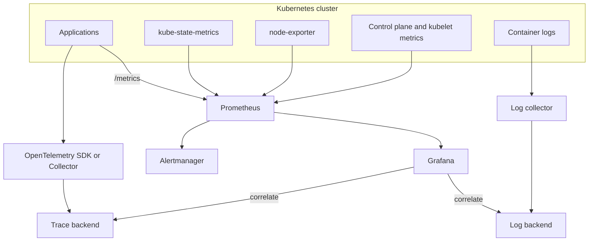

# 01 — Observability Fundamentals

## Monitoring vs observability

**Monitoring** answers predefined questions using known signals and thresholds. **Observability** is the ability to infer a system's internal state from its emitted telemetry, especially when investigating unknown or novel failures.

The common telemetry signals are:

- **Metrics:** numeric measurements over time, such as request rate, error ratio, latency, CPU, memory, queue depth.
- **Logs:** timestamped event records that explain what an individual component did.
- **Traces:** a connected sequence of spans showing a request's path across services.
- **Profiles and events:** additional signals useful for CPU/memory hot spots and changes in system behavior.

The three pillars are complementary, not interchangeable. Metrics reveal that latency increased; traces can identify the slow dependency; logs can explain the specific failure.

## Kubernetes layers to observe

| Layer | Examples |
|---|---|
| Control plane | API server availability/latency, scheduler, controller manager, etcd health |
| Nodes | CPU, memory, filesystem, network, kubelet health |
| Cluster objects | desired vs available replicas, Pod restarts, pending Pods, PVC state |
| Workloads | request rate, error rate, latency, saturation, queue depth |
| User experience | successful transactions, page/API latency, availability |

## The RED and USE methods

For request-driven services, start with **RED**:

- Rate: requests per second.
- Errors: failed requests per second or error ratio.
- Duration: request latency distribution, commonly p50/p90/p95/p99.

For infrastructure resources, use **USE**:

- Utilization: percentage of a resource in use.
- Saturation: queued or waiting work.
- Errors: resource-related errors.

Do not rely on CPU utilization alone to judge application health. A service can be unhealthy because of dependency latency, exhausted connection pools, throttling, or queue growth while CPU remains low.

## Telemetry design principles

1. Give every signal a clear owner and operational question.
2. Use stable labels such as `service`, `namespace`, and `environment`.
3. Avoid unbounded/high-cardinality labels such as user IDs, request IDs, full URLs, and raw exception messages.
4. Keep timestamps and service identity consistent across signals.
5. Protect telemetry endpoints and backends; metrics can expose internal topology.
6. Define retention, sampling, access, and cost limits.
7. Test alerts and dashboards during normal operations, not only during incidents.

## Reference architecture

## Common anti-patterns

- Treating every metric threshold as an alert.
- Alerting on symptoms without actionable runbooks.
- Using logs as the only health signal.
- Collecting every possible label without cardinality controls.
- Keeping all telemetry forever without retention or cost planning.
- Exposing monitoring UIs through an unauthenticated public Service or Ingress.

## Further reading

- https://opentelemetry.io/docs/concepts/observability-primer/
- https://prometheus.io/docs/introduction/overview/
