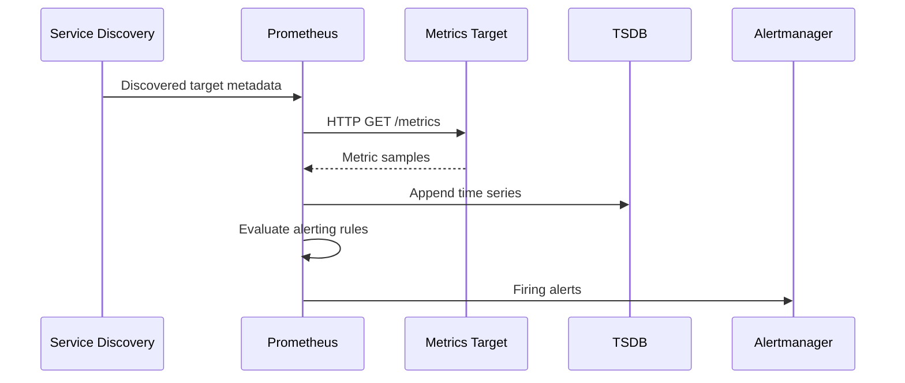

# 02 — Prometheus Architecture

## What Prometheus does

Prometheus is an open-source monitoring and alerting system designed around time-series data. A time series is identified by a metric name and a set of labels, with timestamped sample values.

Prometheus commonly uses a **pull model**: it discovers targets and periodically scrapes their HTTP metrics endpoints. It stores samples in its local time-series database (TSDB), evaluates recording and alerting rules, and exposes PromQL for queries.

## Main components

- **Prometheus server:** service discovery, scraping, TSDB, PromQL, rule evaluation.
- **Exporters:** expose metrics for systems that do not natively expose Prometheus metrics.
- **Alertmanager:** groups, deduplicates, routes, silences, and inhibits alerts.
- **Pushgateway:** optional intermediary for short-lived batch jobs; not a general replacement for scraping.
- **Prometheus Operator:** Kubernetes operator that manages Prometheus-related resources and configuration.
- **Grafana:** visualization and dashboarding system; it queries Prometheus and other data sources.

## Scrape lifecycle

1. Service discovery finds a target.
2. Relabeling can keep, drop, or transform target labels.
3. Prometheus requests the configured metrics path, commonly `/metrics`.
4. The endpoint returns Prometheus exposition format or supported OpenMetrics.
5. Samples are ingested into the TSDB.
6. PromQL queries and rules evaluate the stored series.

## Pull vs push

Pull scraping makes target health visible through scrape status and keeps collection control at the monitoring server. Push can be appropriate for short-lived jobs via Pushgateway, remote-write agents, or managed ingestion systems, but design the lifecycle and stale-series behavior carefully.

## Service discovery in Kubernetes

Prometheus can discover Kubernetes endpoints, Pods, Services, and nodes through the Kubernetes API. The Prometheus process needs appropriate RBAC permissions. With Prometheus Operator, custom resources and selectors generate scrape configuration.

## Storage and retention

Prometheus local TSDB is optimized for recent operational metrics. Plan:

- retention by time and/or size;
- persistent volumes and backup expectations;
- disk growth and compaction;
- high availability and failure-domain separation;
- remote write or long-term storage where required.

Prometheus replicas are not automatically a complete long-term storage or global query solution. Deduplication and query federation/remote storage require deliberate architecture.

## Availability and security

- Run replicas across failure domains when supported by the deployment.
- Restrict access to Prometheus UI and administrative APIs.
- Use network policies and authentication proxies where appropriate.
- Avoid exposing scrape endpoints to untrusted networks.
- Apply resource requests/limits and monitor the monitoring stack itself.

## Official documentation

- https://prometheus.io/docs/introduction/overview/
- https://prometheus.io/docs/prometheus/latest/configuration/configuration/
- https://prometheus.io/docs/prometheus/latest/storage/
