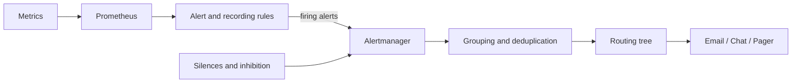

# 08 — Alert Rules and Alertmanager

## Alerting flow

Prometheus evaluates alerting rules. When an expression remains true for its configured `for` duration, the alert becomes firing and is sent to Alertmanager. Alertmanager groups related alerts, deduplicates repeats, routes notifications, supports silences, and applies inhibition rules.



## Alert quality

A useful alert is:
- actionable by the receiving team;
- tied to user impact or a meaningful risk;
- resistant to short-lived noise;
- labeled with service, namespace, severity, and ownership;
- linked to a runbook or dashboard.

Page on urgent user-impacting conditions. Use tickets or dashboards for lower-priority trends. Avoid alerting on every Pod restart without context.

## Example PrometheusRule

See `../manifests/prometheus-rule.yaml`. The example detects a sustained unavailable Deployment replica condition using kube-state-metrics. It assumes the metric is being scraped and the Prometheus resource selects this `PrometheusRule`.

## Alertmanager configuration concepts

- **Route:** match labels and send to a receiver.
- **Receiver:** notification integration.
- **Group:** combine related alerts.
- **Group wait/interval:** control notification timing.
- **Repeat interval:** resend unresolved notifications.
- **Silence:** temporary suppression with a reason and expiry.
- **Inhibition:** suppress lower-severity alerts when a related higher-severity alert is firing.

Never commit real webhook URLs, tokens, SMTP passwords, or paging credentials. Use the chart/operator's supported Secret references or an external secret system.

## Test and validate

```bash
kubectl get prometheusrule -A
kubectl get alertmanager -A
kubectl logs -n monitoring deploy/monitoring-kube-prometheus-alertmanager
```

Rule validation tools and exact commands depend on the Prometheus version and chart. Validate configuration before rollout and test the notification path with a controlled, non-production alert.

## Runbook fields

Include: symptom, impact, first checks, dashboards, safe mitigations, escalation owner, and recovery verification. A runbook should not instruct operators to delete resources blindly.

## Further reading

- https://prometheus.io/docs/alerting/latest/overview/
- https://prometheus.io/docs/prometheus/latest/configuration/alerting_rules/
