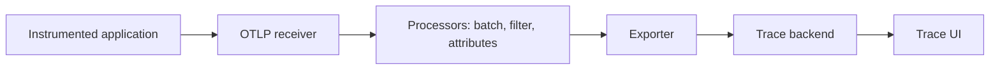

# 10 — OpenTelemetry and Distributed Tracing

## Distributed tracing

A trace represents the path of one request through a distributed system. A trace contains spans; spans represent timed operations and can have attributes, events, status, and parent-child relationships.

Trace context is propagated between services using a standard format such as W3C Trace Context (`traceparent`). Without propagation, a request may appear as disconnected traces.

## OpenTelemetry

OpenTelemetry (OTel) is a vendor-neutral collection of APIs, SDKs, semantic conventions, and collectors for generating and exporting telemetry. It is not a backend or visualization product.

Typical components:
- API and SDK in application code;
- auto-instrumentation where supported;
- OTLP exporter;
- OpenTelemetry Collector;
- trace backend such as Jaeger, Tempo, or a managed service.

## Collector pipeline

A Collector pipeline is configured with receivers, processors, exporters, and service pipelines. Exact component names and configuration depend on the Collector distribution and version.

## Kubernetes deployment patterns

- Agent/DaemonSet for node-local collection.
- Gateway/Deployment for centralized processing.
- Sidecar only when isolation or local processing justifies its operational overhead.
- Use TLS and authentication for cross-cluster or external export.
- Set memory limits and configure batch/retry/queue behavior.

## Sampling

Head sampling decides at trace creation time. Tail sampling makes decisions after observing more of the trace and generally requires traces to be routed consistently to the same collector decision point. Sampling reduces cost but may hide rare failures if policies are poorly designed.

## Correlation

Use trace IDs in logs and exemplars where supported to navigate from a metric spike to representative traces and related logs. Do not use trace IDs as metric labels because they create extreme cardinality.

## Security and privacy

Avoid exporting secrets, authorization headers, raw request bodies, and sensitive user attributes. Apply attribute filtering and data minimization before telemetry leaves the cluster.

## Further reading

- https://opentelemetry.io/docs/
- https://opentelemetry.io/docs/concepts/signals/traces/
- https://opentelemetry.io/docs/collector/
