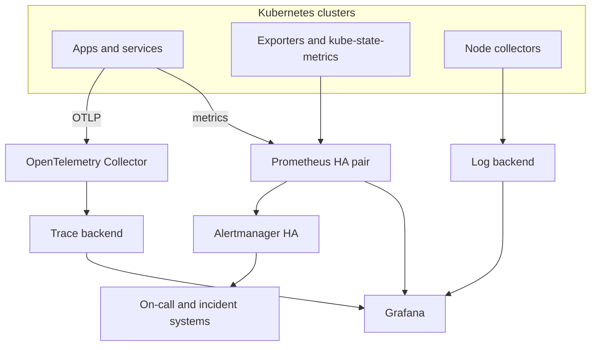

# 12 — Production Observability Architecture

## Design goals

A production observability platform should be reliable, secure, scalable, cost-aware, and useful during incidents. Avoid making the monitoring system a single point of failure for operations.

## Reference design

This is a conceptual architecture. Actual deployment may use managed services, remote write, multi-cluster federation, or separate telemetry platforms.

## Capacity and retention

Estimate ingestion rate, active series, scrape interval, histogram bucket count, log volume, trace volume, and retention. Set explicit limits and monitor ingestion drops, queue saturation, compaction, and backend storage growth.

Do not assume a single Prometheus instance can serve as an unlimited global metrics store. Consider remote storage or a scalable metrics backend when retention, availability, or multi-cluster requirements exceed local TSDB design.

## High availability

- Spread replicas across nodes and zones.
- Use persistent storage where required.
- Ensure alert delivery remains available during a Prometheus failure.
- Avoid shared failure domains for collectors and backends.
- Document recovery procedures and test them.

## Security controls

- Restrict access using RBAC, authentication, and network policy.
- Encrypt traffic in transit and storage where supported.
- Store credentials in Secret management systems.
- Limit access to sensitive labels, logs, traces, and dashboards.
- Keep audit trails for administrative changes.
- Review retention and privacy obligations.

## Monitor the monitoring system

Track:
- Prometheus target availability and scrape duration;
- samples ingested, rejected, and dropped;
- rule evaluation duration and failures;
- TSDB disk usage and compaction;
- Alertmanager notification failures;
- collector queue size, retries, and dropped telemetry;
- backend query latency and ingestion health.

## Operational practices

- Version dashboards, rules, and configuration in Git.
- Test alert rules and dashboards before deployment.
- Pin Helm chart versions and review CRD upgrade steps.
- Use runbooks and clear service ownership.
- Review cardinality and telemetry cost regularly.
- Perform failure drills: stop a target, fill a test queue, simulate a slow dependency, and verify alert routing.

## Further reading

- https://prometheus.io/docs/practices/
- https://sre.google/sre-book/monitoring-distributed-systems/
