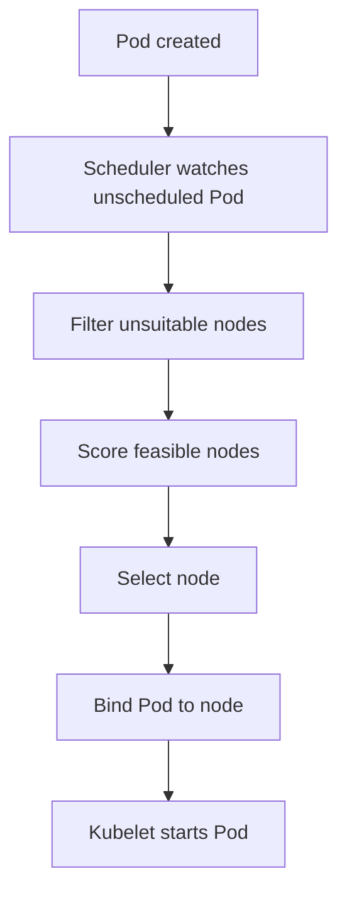

# 01 — Scheduling Fundamentals

Kubernetes scheduling assigns an unscheduled Pod to a suitable node. The scheduler evaluates constraints and resource availability; the kubelet on the selected node then works to create the containers.

## Main inputs
- CPU and memory requests.
- Node labels and node affinity.
- Pod affinity and anti-affinity.
- Taints and tolerations.
- Topology spread constraints.
- Volume topology and PVC binding.
- Pod priority and preemption.
- Scheduler profiles, plugins, and policies.

## Scheduling is not runtime health
A Pod in `Running` phase may still be unready or failing. Scheduling only places it; probes, controllers, kubelet, networking, and storage determine subsequent operation.

## High-level flow


## Inspect placement
```bash
kubectl get pods -A -o wide
kubectl describe pod <pod>
kubectl get nodes --show-labels
kubectl describe node <node>
```
