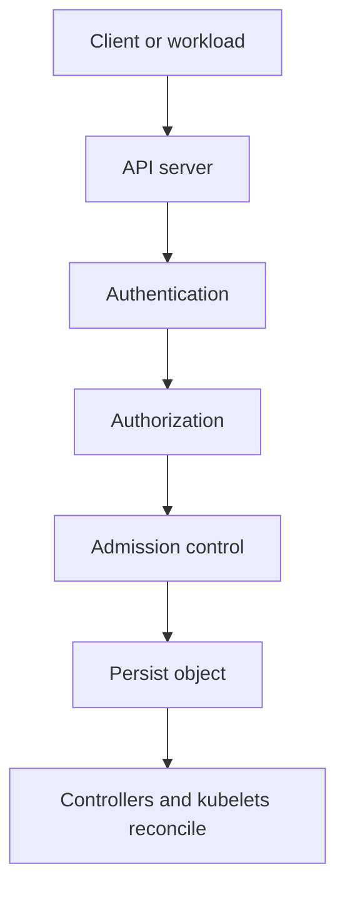

# 01 — Kubernetes Security Model

Kubernetes security is a set of controls across the control plane, API access, workload identity, node boundary, network, image supply chain, storage, and operations.

## Core control areas
- **Authentication:** who or what is making the API request?
- **Authorization:** is that identity allowed to perform the requested action?
- **Admission:** should the API server accept or mutate this object?
- **Workload hardening:** what can the process do inside its container?
- **Network isolation:** which workloads can communicate?
- **Supply chain:** where did the image come from, and is it trustworthy?
- **Detection and response:** can suspicious actions be identified and investigated?

## Request path

## Defense in depth
No single feature is a complete security boundary. RBAC does not restrict network traffic; NetworkPolicy does not authorize API calls; Pod Security Standards do not scan images; image scanning does not prevent an overprivileged ServiceAccount.

## Threat-model questions
- Which identities can access the API?
- What is the blast radius of a compromised Pod?
- Can a workload access the Kubernetes API unnecessarily?
- Can a container modify its filesystem, gain Linux capabilities, or access host namespaces?
- Can an attacker move laterally across namespaces?
- Are audit logs retained outside the cluster?

Start with least privilege, secure defaults, short-lived credentials where supported, and tested incident runbooks.
