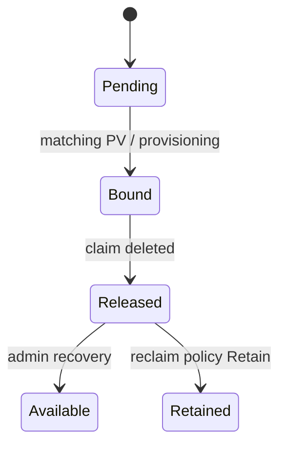

# 03 — PersistentVolumes and PersistentVolumeClaims

- **PV:** cluster-scoped resource representing provisioned storage.
- **PVC:** namespaced request for storage.
- **StorageClass:** describes a class of storage and its provisioner/parameters.

## Binding lifecycle


## PVC example
```yaml
apiVersion: v1
kind: PersistentVolumeClaim
metadata:
  name: app-data
spec:
  accessModes: [ReadWriteOnce]
  resources:
    requests:
      storage: 5Gi
```
This normally uses the default StorageClass if configured. `storageClassName: ""` deliberately disables default-class selection and is generally used for static binding.

## Matching
Capacity, access modes, volume mode, StorageClass, and optional selectors affect binding. A PVC may remain Pending when no compatible PV exists or dynamic provisioning fails.

```bash
kubectl get pv
kubectl get pvc -A
kubectl describe pvc app-data
kubectl get events --sort-by=.lastTimestamp
```

Bound means a claim is matched to a volume; it does not prove that a Pod can mount it, that it is writable, healthy, performant, or backed up.
