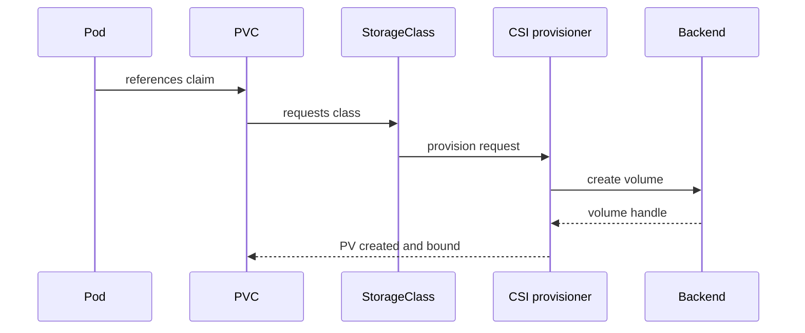

# 04 — StorageClasses and Dynamic Provisioning

A StorageClass allows users to request storage characteristics without manually creating a PV. Its `provisioner` names the CSI driver or provisioner; parameters are driver-specific.



Inspect classes:
```bash
kubectl get sc
kubectl describe sc <class>
kubectl get sc <class> -o yaml
```

`Immediate` provisions/binds as soon as the claim is created. `WaitForFirstConsumer` delays binding until a Pod uses the PVC, allowing topology and scheduling to be considered together—important for zonal disks.

Reclaim policy is commonly `Delete` by default for dynamically provisioned volumes when omitted. `Retain` requires an administrator-managed recovery workflow. Expansion requires `allowVolumeExpansion: true`, driver support, and filesystem support.

`manifests/storageclass-placeholder.yaml` is deliberately nonfunctional. Replace its provisioner and parameters using the exact installed CSI driver's documentation; do not apply unchanged.
