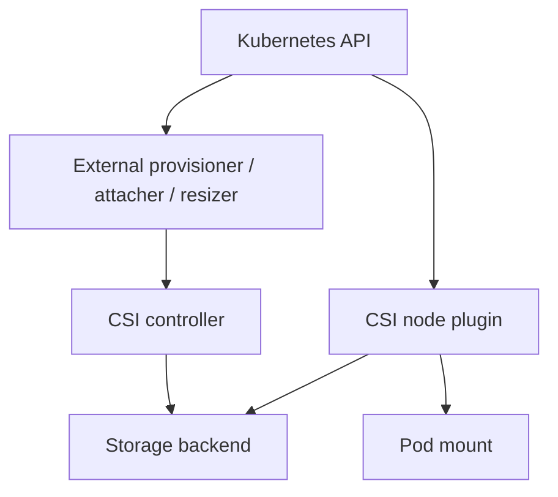

# 07 — Container Storage Interface (CSI)

CSI standardizes communication between Kubernetes and storage systems.

## Components
- External provisioner: watches PVCs and requests volume creation.
- External attacher: coordinates attach/detach where needed.
- External resizer: handles supported expansion.
- External snapshotter: coordinates snapshots.
- CSI controller service: create/delete/attach/snapshot operations.
- CSI node service: stages and mounts volumes on workers.



Inspect:
```bash
kubectl get csidrivers
kubectl get csinodes
kubectl get pods -A | grep -i csi
kubectl describe csidriver <driver>
```

Capabilities vary by driver: dynamic provisioning, attach/detach, expansion, snapshots, cloning, topology, RWX/RWOP, encryption, and health reporting. For failures inspect PVC/PV events, VolumeAttachment objects, CSI controller logs, node-plugin logs, and provider-side events. Avoid blind restarts.
