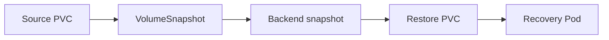

# 09 — Expansion, Topology, Snapshots, and Clones

## Expansion
Typical requirements: StorageClass allows expansion, CSI driver supports it, and filesystem supports growth. Increase requested size:
```bash
kubectl patch pvc app-data -p '{"spec":{"resources":{"requests":{"storage":"10Gi"}}}}'
kubectl get pvc app-data -w
kubectl describe pvc app-data
```
Shrinking PVCs is not a normal supported operation. Confirm filesystem size inside the Pod.

## Topology
Zonal volumes may only attach in their provisioned zone. `WaitForFirstConsumer` helps align provisioning with Pod scheduling. Inspect PV node affinity and Pod events.

## Snapshots
Requires snapshot CRDs, external snapshot controller, a compatible CSI driver, and a real VolumeSnapshotClass. The API is not guaranteed to exist on every cluster.

```yaml
apiVersion: snapshot.storage.k8s.io/v1
kind: VolumeSnapshot
metadata:
  name: app-data-snapshot
spec:
  volumeSnapshotClassName: <snapshot-class>
  source:
    persistentVolumeClaimName: app-data
```



Restore uses a PVC `dataSource` referring to the VolumeSnapshot. Class/driver compatibility is required. Cloning from an existing PVC is also driver-dependent; it is not a universal file-copy feature.

Check APIs/classes:
```bash
kubectl api-resources | grep -i snapshot
kubectl get volumesnapshotclass
kubectl get volumesnapshot -A
```
